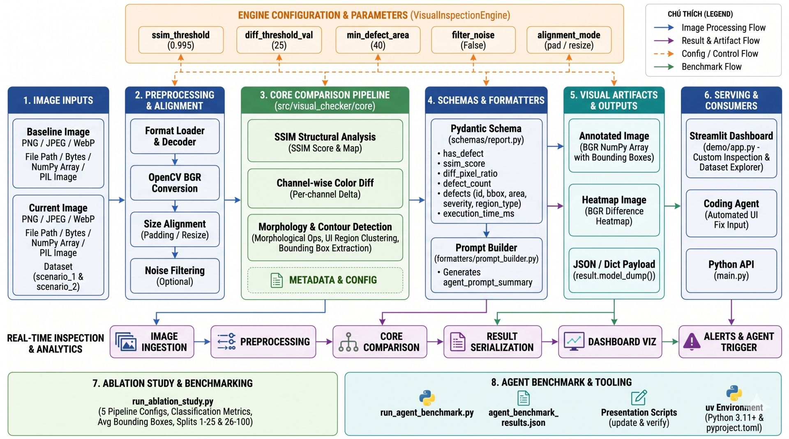

# Visual Inspection Module

Module Python phát hiện và định vị khác biệt giao diện giữa ảnh chuẩn (baseline) và ảnh hiện tại. Pipeline kết hợp so sánh cấu trúc SSIM, sai khác màu theo từng kênh, xử lý hình thái học và contour detection. Kết quả gồm trạng thái có lỗi, bounding box, ảnh heatmap, ảnh đánh dấu vùng khác biệt và phần tóm tắt có thể chuyển tiếp cho coding agent.

## Tính năng

- So sánh ảnh PNG, JPEG, WebP từ đường dẫn, bytes, NumPy array hoặc PIL Image.
- Căn chỉnh kích thước ảnh bằng padding hoặc resize.
- Phát hiện khác biệt cấu trúc và màu, sau đó gom cụm thành vùng UI.
- Trả về SSIM, tỷ lệ pixel khác biệt, bounding box, mức độ lỗi và thời gian xử lý.
- Dashboard Streamlit để kiểm tra ảnh tùy chọn và xem kết quả benchmark khi có dataset.

## Cấu trúc dự án

```text
visual-inspection-module/
├── demo/app.py                       # Streamlit dashboard
├── src/visual_checker/
│   ├── core/                          # Tiền xử lý, so sánh, morphology, phát hiện vùng lỗi
│   ├── formatters/prompt_builder.py   # Tạo tóm tắt cho agent
│   ├── schemas/report.py              # Pydantic result và bounding box
│   └── engine.py                      # VisualInspectionEngine
├── scripts/
│   ├── update_presentation.py
│   └── verify_presentation.py
├── run_ablation_study.py              # So sánh các cấu hình pipeline
├── run_agent_benchmark.py             # Tạo báo cáo benchmark agent mẫu
├── agent_benchmark_results.json       # Kết quả benchmark đã lưu
├── main.py                            # Entry point mẫu
├── pyproject.toml
└── uv.lock
```

## Yêu cầu

- Python 3.11 trở lên
- [`uv`](https://docs.astral.sh/uv/)

## Cài đặt

Tại thư mục gốc của repository:

```bash
uv sync
```

`uv sync` tạo/cập nhật môi trường ảo và cài các dependency khai báo trong `pyproject.toml`. Không cần cài browser Playwright để dùng engine hoặc chạy dashboard với ảnh tải lên.

## Chạy dashboard

```bash
uv run streamlit run demo/app.py
```

Streamlit sẽ in URL local trong terminal (mặc định `http://localhost:8501`). Tab **Custom Image Inspection** cho phép tải lên một ảnh baseline và một ảnh cần kiểm tra. Các tab duyệt dataset và benchmark yêu cầu dataset riêng theo cấu trúc bên dưới.

## Dùng trong Python

```python
import sys
from pathlib import Path

sys.path.insert(0, str(Path("src").resolve()))

from visual_checker import VisualInspectionEngine

engine = VisualInspectionEngine()
result, annotated_image, heatmap = engine.compare(
    "baseline.png",
    "current.png",
)

print(result.model_dump())
print(result.agent_prompt_summary)
```

`result` là `VisualInspectionResult` với các trường `has_defect`, `ssim_score`, `diff_pixel_ratio`, `defect_count`, `defects`, `agent_prompt_summary` và `execution_time_ms`. `annotated_image` và `heatmap` là NumPy arrays theo định dạng màu OpenCV (BGR).

Các tham số engine có thể tùy chỉnh khi khởi tạo:

```python
engine = VisualInspectionEngine(
    ssim_threshold=0.995,
    diff_threshold_val=25,
    min_defect_area=40,
    filter_noise=False,
    alignment_mode="pad",
)
```

`alignment_mode` hỗ trợ `pad` và `resize`.

## Dataset và benchmark

Dataset không được lưu trong repository này. Dashboard và `run_ablation_study.py` tìm dữ liệu ở thư mục `dataset/` nằm cạnh thư mục repository, tức `../dataset/` khi chạy từ repository này. Các script benchmark mong đợi cấu trúc:

```text
dataset/
├── scenario_1/
│   ├── baseline/sample_*.png
│   └── current/sample_*.png
└── scenario_2/
    ├── baseline/sample_*.png
    └── current/sample_*.png
```

`scenario_1` là các cặp không có lỗi; `scenario_2` là các cặp có lỗi. Cần có ảnh baseline và current tương ứng trong từng thư mục. Nếu không có dataset, dashboard vẫn dùng được ở tab tải ảnh tùy chọn; những phần benchmark dựa trên dataset sẽ không chạy đầy đủ.

Khi đã đặt dataset đúng vị trí:

```bash
uv run python run_ablation_study.py
```

Script này chạy năm cấu hình so sánh và in các chỉ số phân loại cùng số bounding box trung bình. Dashboard cũng có benchmark theo các split mẫu 1-25 và 26-100; các split này giả định dataset gồm 100 mẫu cho mỗi scenario.

Benchmark Agent có thể chạy riêng:

```bash
uv run python run_agent_benchmark.py
```

Script này tạo/cập nhật `agent_benchmark_results.json` từ bộ tình huống và số liệu được khai báo trong script. Đây là báo cáo đánh giá mẫu, không gọi dịch vụ LLM hay thực thi một coding agent trực tiếp.

## API kết quả

Mỗi defect gồm `id`, `bbox` (`x`, `y`, `width`, `height`), `area`, `severity` và `region_type`. Dùng `result.model_dump()` để chuyển kết quả Pydantic thành dictionary/JSON-compatible payload.

## Kiến trúc tổng thể
